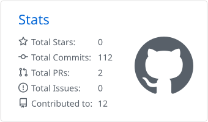
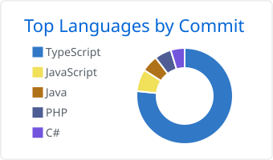

<h1 align="center">Salut, moi c'est Mouhammad 👋</h1>
<h3 align="center">Ingénieur logiciel Full Stack · Fondateur de <a href="https://beam.sn">Beam</a> · Dakar, Sénégal 🇸🇳</h3>

  
  

---

### 🧑‍💻 À propos

Je conçois et développe des applications web **performantes, maintenables et scalables**, de la conception jusqu'à la mise en production.

- 🚀 Fondateur et développeur de **[Beam](https://beam.sn)**, une marketplace en production avec **plus de 4 000 utilisateurs actifs**
- ☁️ Expérience sur des architectures **serverless AWS** et l'**Infrastructure as Code** (AWS CDK)
- 🎓 Master en Génie Logiciel et Systèmes d'Information à l'**École Supérieure Polytechnique** de Dakar
- 💬 Je parle français et anglais

---

### 🛠️ Stack technique

**Front-end**

  
  
  
  
  

**Back-end**

  
  
  
  
  

**Mobile**

  
  

**Bases de données & ORM**

  
  
  
  

**Cloud & DevOps**

  
  
  
  
  

---

### 🌟 Projet phare : Beam

> **[Beam](https://beam.sn)** : marketplace SaaS que j'ai fondée et que je développe seul de bout en bout depuis 2025.

- **Front :** Next.js + TypeScript
- **Back :** API REST sécurisées avec NestJS, authentification JWT et gestion des rôles
- **Données :** PostgreSQL + Prisma
- **Infra :** conteneurisation Docker, mise en production et suivi des performances
- 📈 **Plus de 4 000 utilisateurs actifs** et des revenus réels

---

### 💼 Parcours

| Poste | Entreprise | Période |
|---|---|---|
| Ingénieur logiciel Full Stack | Freewan, Dakar | 01/2026 – 10/2026 |
| Développeur Full Stack | Engy Partner, Dakar | 09/2025 – 02/2026 |
| Stagiaire développeur Full Stack | InovatelQ, Dakar | 06/2024 – 08/2024 |

Voir le détail

**Freewan** : interfaces Next.js / React / TypeScript pour plusieurs plateformes métier, infrastructures AWS en IaC avec AWS CDK, architectures serverless (Lambda, API Gateway, RDS PostgreSQL), gestion des secrets avec Secrets Manager, fonctionnalités métier (rôles, workflows, tableaux de bord, rendez-vous, supervision).

**Engy Partner** : modules front-end React / TypeScript, API REST, participation à une architecture microservices, optimisation des performances, revues de code et pull requests.

**InovatelQ** : plateforme de gestion de livraisons en React.js, API REST avec Express.js, conception de schémas MySQL.

---

### 📊 Statistiques GitHub

  <picture>
    <source media="(prefers-color-scheme: dark)" srcset="./profile-summary-card-output/github_dark/3-stats.svg">
    
  </picture>
  <picture>
    <source media="(prefers-color-scheme: dark)" srcset="./profile-summary-card-output/github_dark/2-most-commit-language.svg">
    
  </picture>

<i>Ouvert aux opportunités et aux collaborations. N'hésite pas à me contacter !</i>

